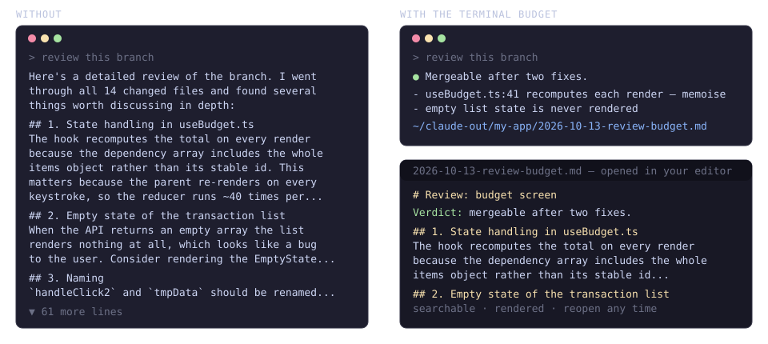

# verdict

[](https://github.com/Gr0mar/verdict/actions/workflows/tests.yml)
[](LICENSE)


A terminal budget for [Claude Code](https://code.claude.com) and [Codex](https://developers.openai.com/codex). The output style asks for replies within **12 lines / 900 characters** — the verdict first, up to three bullets, done — with anything longer (a code review, a research summary, a design proposal, a message you will forward) written to a Markdown file under `~/claude-out/` that opens in your editor by itself. A Stop hook measures every final reply; when one is over budget and no file was written, Claude is sent back once to move the content to a file and answer briefly.



## Why

- **You are there to decide, not to read.** Claude Code answers with pages; what you need from each turn is the answer, the question it has for you, or the sign that something went wrong. With the verdict first, the decision takes seconds — and you keep an overview of what the AI is doing without reading everything it writes.
- **The details are moved, not lost.** The full review, research or plan lands in a file that opens in your editor — rendered, searchable, reopenable, ready to paste into a ticket — instead of a 5 000-character block in scrollback that is gone after the next command.
- **Measured, not just requested.** Instructions in `CLAUDE.md` drift under long sessions and plugins. A hook runs on every reply: when the model ignores the rule, it is sent back to write the file and answer again.
- **Long content becomes files.** Reviews, research and plans live under `~/claude-out/<project>/` where you can reopen, diff and share them instead of losing them in the scrollback.
- **One phrase lifts the budget** for a single turn when you do want the whole thing in the terminal.
- **Logged.** Every decision is recorded, so you can see how often the model needed the nudge — and whether your wording of the rule works.
- Three small dependency-free Node scripts; `install.sh --uninstall` restores your settings.

## How it works

| piece | event | job |
|---|---|---|
| `hooks/budget-prompt.js` | `UserPromptSubmit` | notes whether you asked for the full text this turn; resets the list of files written |
| `hooks/budget-open.js` | `PostToolUse` on `Write` (Claude Code) or `apply_patch` (Codex) | records every Markdown file written under `outDir` and starts `openCommand` on it |
| `hooks/budget-stop.js` | `Stop` | measures the final reply; over budget it blocks once with an instruction to write the file and answer briefly |
| `output-styles/verdict.md` | output style | the rule itself: verdict first, long content to a file |

One turn: you send a prompt → Claude works, writes `~/claude-out/<project>/<date>-<slug>.md` when the content is long (the file opens) → the Stop hook measures the reply. Within budget: done. Over budget without a file: the hook blocks, Claude writes the file and replies again. The second round is never blocked (and Claude Code caps hook continuations at eight), so there is no loop.

What the hook cannot do: take text back. It runs after the reply is on screen, so on a blocked turn you see the long reply, the hook's note, the file being written, and then the short answer. The output style is what keeps the long text off the screen in the first place; every `block_*` line in the log is one turn where the style was not followed — the number to watch.

## Requirements

- Claude Code **2.1.143 or newer** (the Stop hook's `last_assistant_message` field and the cap on hook continuations). On older 2.1 releases the hook sees no reply text, logs `allow_empty` and enforces nothing.
- Or Codex CLI with lifecycle hooks (0.114 or newer; hooks are on by default). The same three scripts run there — Codex's hook events and fields match.
- Node 22 or newer. No npm dependencies.
- An opener: macOS uses `open -a <openApp>` (default Cursor); other systems default to `xdg-open`. Set `openCommand` for anything else.

## Install

**Claude Code, as a plugin** (recommended — two commands, nothing to clone):

```
/plugin marketplace add Gr0mar/verdict
/plugin install verdict@gr0mar
```

The plugin bundles the hooks, the output style (applied automatically while the plugin is enabled) and the skills, which run as `/verdict:fresh`, `/verdict:copilot` and `/verdict:pull`. `/plugin uninstall verdict@gr0mar` removes everything. Pick one method: the plugin or the checkout below, not both — otherwise every hook runs twice.

**From a checkout** (Claude Code via `install.sh`, or Codex):

```sh
git clone https://github.com/Gr0mar/verdict.git ~/verdict
cd ~/verdict
./install.sh            # Claude Code
./install.sh --codex    # Codex
```

**Claude Code:** `install.sh` symlinks the hooks, the output style and the skills into `~/.claude/` and registers the hooks plus `"outputStyle": "verdict"` in `~/.claude/settings.json` — the file is rewritten after a backup, the merge is idempotent, and no other file is touched: a target that already exists and is not our symlink aborts the install. Restart Claude Code afterwards: hooks reload into running sessions, the output style is read at startup.

**Codex:** `install.sh --codex` registers the hooks in `~/.codex/hooks.json` (pointing at this checkout), puts the rule into `~/.codex/AGENTS.md` between `<!-- verdict:start -->` and `<!-- verdict:end -->` markers (Codex has no output styles; the rest of the file is left alone), and links the skills into `~/.codex/skills/`. The rule alone already works in the Codex desktop app: replies come as a verdict with a link to the full file. The hooks add enforcement and the automatic opening, and Codex skips hooks it has not been told to trust — run `/hooks` in the CLI once and trust the three verdict hooks.

```sh
./install.sh --uninstall           # Claude Code: removes the symlinks and hook entries, restores the outputStyle active at install time
./install.sh --codex --uninstall   # Codex: removes the hook entries, the AGENTS.md block and the skill links
```

## Asking for the full text

Say so in the prompt and the budget is lifted for that one turn:

- English: `elaborate`, `in detail`, `in full`, `verbatim`, `show me everything`, `paste it here`, `show me the code`, `give me the command`, `show me the full output`, `print the whole thing`, `put it in the terminal`, `verbose`
- Czech: `rozveď`, `podrobně`, `do terminálu`, `vypiš celé`, `ukaž mi kód`, `dej mi ten příkaz`

The pattern matches request phrases, not bare words: `detail view`, `full width`, `show all toggle`, `--verbose flag` or `code review of the whole branch` do not lift the budget. It is a configurable regex (`detailPattern`); words inside pasted content are ignored. The output style also tells Claude to keep security warnings, confirmations of destructive actions and requested code in the terminal — but the hook measures those replies like any other, so ask with one of the phrases above when such a reply will be long.

## Configuration

`~/.config/verdict/budget.json`, every field optional:

| field | default | meaning |
|---|---|---|
| `maxLines` | `12` | terminal line budget (trailing blank lines do not count) |
| `maxChars` | `900` | terminal character budget |
| `outDir` | `"~/claude-out"` | where long content is written; files are opened only from here |
| `openApp` | `"Cursor"` | macOS shorthand for `openCommand: ["open", "-a", "<app>"]`; ignored once `openCommand` is set and on other systems |
| `openCommand` | `["open", "-a", "Cursor"]` on macOS, `["xdg-open"]` elsewhere | JSON array: executable plus arguments, the file path is appended; `~` is not expanded in the executable |
| `detailPattern` | request phrases, English + Czech | case-insensitive regex that lifts the budget for one turn |

Files land in `<outDir>/<project>/<YYYY-MM-DD>-<slug>.md`, where `<project>` is the basename of Claude's working directory.

The output style and the skills carry the defaults in their text (`12 lines`, `900 characters`, `~/claude-out`). When you change `maxLines`, `maxChars` or `outDir`, edit `output-styles/verdict.md` and `skills/*/SKILL.md` to match — the hook enforces the config, the style tells Claude what to aim for.

## Log and metrics

Every Stop decision appends one line to `~/.claude/state/verdict/budget.log.jsonl`:

```json
{"ts":"2026-10-13T12:46:51.710Z","session_id":"…","cwd":"/Users/me/project","lines":14,"chars":690,"decision":"block_no_file","written":[],"detail":false}
```

`decision` is one of `allow`, `block_no_file`, `block_shorten`, `allow_detail`, `allow_empty`, `allow_after_block`. A blocked turn logs two lines (the block and the retry), so count turns without the retries:

```sh
grep -c '"decision":"block' ~/.claude/state/verdict/budget.log.jsonl             # turns that needed the nudge
grep -vc '"decision":"allow_after_block"' ~/.claude/state/verdict/budget.log.jsonl   # all turns
```

Per-session state lives next to the log (`<session_id>.json`, mode 0600) and is pruned after seven days.

## Skills

Three slash commands for prompts people type again and again. Each is a plain `SKILL.md`; edit the wording to taste.

- `/fresh [scope]` — a fresh-eyes review of the work in this session, or of a named scope: weak spots, unclear parts, unfinished pieces.
- `/copilot` — process GitHub Copilot's review comments on the current PR: apply the justified ones, draft replies for the rest, and — after you approve — post the replies and resolve the threads.
- `/pull [what you expect]` — bring the repository you are in up to date: fast-forward pull on a clean tree, dependency install when the lockfile changed, `generate-api` when the project has that script, and a report of what changed.

## Limitations

- Only the final message of a turn is measured; narration between tool calls is not, and the retry after a block is not measured again.
- Lines are counted on `\n`, not on rendered height; the character budget bounds wrapping.
- Files are detected through Claude Code's `Write` tool and Codex's `apply_patch`; a file produced by a shell command is not opened.
- The hooks run through symlinks into this checkout, so an edit here is live in every session immediately. They fail open: on any internal error a hook exits 0 and prints nothing.

## Development

```sh
npm test   # node:test; hooks run as child processes in temporary sandboxes
```

```
hooks/            budget-config.js (shared), budget-prompt.js, budget-open.js, budget-stop.js
output-styles/    verdict.md
skills/           fresh/, copilot/, pull/
install/          merge-settings.js — idempotent hooks merge for settings.json (Claude Code) and hooks.json (Codex)
                  agents-md.js — the rule as a marked block in Codex's AGENTS.md
install.sh
test/
```

## Licence

[MIT](LICENSE)
